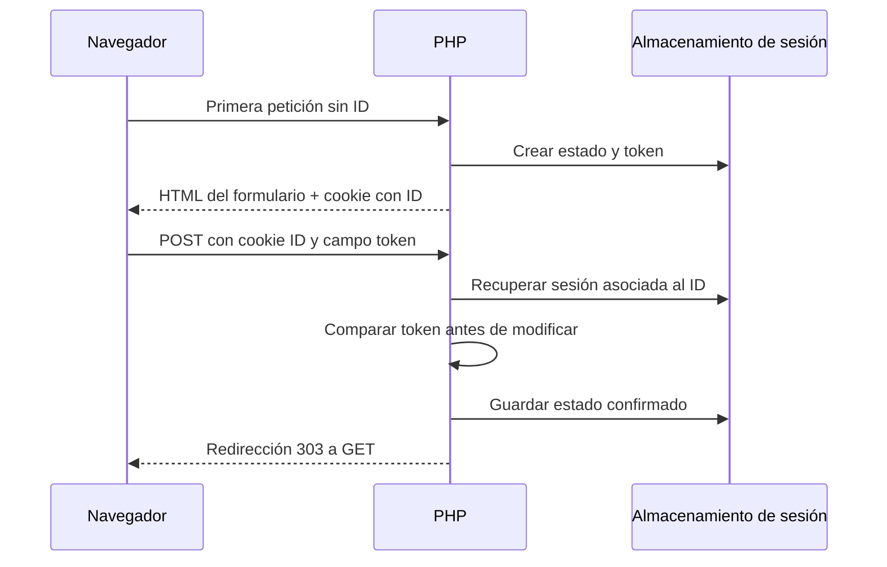

# Unidad 11. Sesiones, cookies y protección CSRF

[Anterior](../unidad10-formularios/README.md) · [Índice](../README.md) · [Siguiente](../unidad12-pdo/README.md)

[Práctica](PRACTICA.md) · [Soluciones](SOLUCIONES.md)

## Lo que aprenderás

Conservar estado entre peticiones y proteger las operaciones del formulario.

Requisito: haber completado la unidad anterior. Si un concepto te cuesta, vuelve a su ejemplo antes de avanzar. Todos los comandos parten de `cursos/php`.

## Explicación

Una cookie viaja entre navegador y servidor. Una sesión guarda datos en el servidor y utiliza normalmente una cookie con un identificador para recuperar ese estado. Llama a `session_start` antes de emitir HTML. No guardes contraseñas en cookies. Para una sesión autenticada configura HttpOnly, SameSite y Secure bajo HTTPS; al iniciar sesión regenera el identificador.

CSRF ocurre cuando otra página provoca una operación usando las credenciales que el navegador envía automáticamente. Un token aleatorio asociado a la sesión debe acompañar cada formulario que cambie datos. Créalo con `bin2hex(random_bytes(32))`, consérvalo en $_SESSION, envíalo en un campo hidden y compáralo con `hash_equals` después de comprobar que ambos valores son cadenas. Rechaza un token ausente o incorrecto con 403 antes de escribir. SameSite ayuda, pero no sustituye esta comprobación.

No hagas cambios por GET: un enlace, vista previa o robot podría activarlos. Un mensaje flash se guarda en sesión durante la redirección y se elimina al mostrarlo. Una sesión tampoco reemplaza la autorización: conocer un ID no implica permiso para editarlo. Los ejemplos siguientes modelan el estado con arreglos locales; el proyecto usa una sesión real y formularios con token.

## Estado compartido entre peticiones, no entre todas las personas

Una sesión permite relacionar peticiones con un estado guardado en el servidor. Al iniciarla, PHP obtiene o crea un identificador y normalmente lo comunica mediante una cookie. En la siguiente petición el navegador devuelve esa cookie; PHP busca los datos asociados y reconstruye $_SESSION. No envía al navegador todo el arreglo de sesión. Saber dónde vive cada pieza evita guardar más información de la necesaria en el cliente.

Dos navegadores o perfiles pueden tener identificadores diferentes y, por tanto, estados distintos. Dos pestañas del mismo perfil y origen suelen compartir la cookie y la sesión. Una prueba con una pestaña de incógnito sirve para comprobar aislamiento; abrir otra pestaña normal no garantiza un usuario distinto. Tampoco deduzcas que una variable global de PHP identifica al visitante: su duración y alcance son otros.

### Cookie y datos no viajan juntos



El campo del token y la cookie de ID tienen papeles diferentes. El ID selecciona la sesión y el token permite comprobar la procedencia del formulario según ese estado. Ninguno sustituye verificar el permiso de la identidad autenticada cuando la operación lo requiere.

### Atributos de cookie y sus límites

HttpOnly impide que JavaScript del documento lea directamente la cookie. No evita que un XSS realice peticiones autenticadas desde la página. Secure exige HTTPS para enviar la cookie en el transporte previsto; si lo activas mientras estudias por HTTP local, puedes perder continuidad de sesión. SameSite limita ciertos envíos entre sitios y ayuda frente a CSRF, pero no reemplaza la validación del token.

Path controla para qué rutas se envía la cookie y Domain su ámbito de host cuando se configura. No amplíes el dominio para resolver un error sin comprender a qué otros sitios estás dando participación en la misma cookie. La caducidad de la cookie, la conservación de datos en el servidor y el tiempo de inactividad admitido son decisiones relacionadas pero diferentes. Un contador de tiempo por sí solo no implementa una política completa de sesiones.

### CSRF: una petición puede llevar identidad sin intención

El navegador agrega cookies de forma automática según sus reglas. Una página externa puede intentar provocar una operación en otro sitio aprovechando esa identidad que se envía sola. El token CSRF vincula el formulario a un secreto generado en la sesión de la aplicación. El servidor verifica su presencia y coincidencia antes de procesar cambios. Un campo hidden es transportado por el navegador, pero no es confiable solo por estar oculto.

Genera el token mediante random_bytes; no uses una fecha, un contador ni el nombre de la cuenta. Mantén el mismo token durante los formularios normales de una sesión para que dos pestañas no fallen sin necesidad. Renuévalo cuando cambie la identidad o la sesión de manera relevante. No lo coloques en URLs: pueden quedar en historiales, registros o enlaces compartidos. El token debe viajar como parte de la operación de escritura.

### Renovar el identificador al entrar

La fijación de sesión intenta lograr que una persona se autentique usando un identificador conocido previamente por un atacante. session.use_strict_mode ayuda a no aceptar identificadores de sesión inexistentes suministrados por el cliente. Después de una verificación de credenciales exitosa, session_regenerate_id renueva la asociación. Esa renovación y el token CSRF responden a riesgos diferentes y no se sustituyen entre sí.

Al cerrar sesión elimina el estado autenticado; no te limites a ocultar un botón. El proyecto también renueva la sesión y el token. Las rutas protegidas vuelven a comprobar identidad en cada petición, incluida la API. Si solo se comprobara al mostrar la pantalla inicial, alguien podría llamar directamente a la URL de edición o conservar una página antigua abierta.

### Practicar el ciclo completo

El [laboratorio de sesiones](../laboratorios/11-sesiones/README.md) permite guardar una nota de práctica en una sesión real, mostrar un mensaje flash tras una redirección y rechazar un POST sin token. No necesita login ni base: su finalidad es observar continuidad y protección del cambio de estado. No escribas información personal en ese experimento.

Registra la primera respuesta con Set-Cookie, la petición siguiente con Cookie y el lugar del código donde se guarda la nota. No copies el valor del identificador ni del token en evidencias públicas. Para explicar el mecanismo basta su presencia, longitud y cambio cuando corresponda. Un experimento completo debe demostrar el caso permitido y el rechazo sin modificar la nota anterior.

## Ejemplo 1. Un mensaje de una sola lectura

Antes de ejecutar, predice la salida y señala qué instrucción produce cada línea.

[Archivo completo](ejemplos/01.php) · [Salida esperada](ejemplos/01.txt)

```php
<?php
declare(strict_types=1);

$sesion = [];
$sesion["flash"] = "Taller guardado";
$mensaje = $sesion["flash"] ?? "";
unset($sesion["flash"]);
echo $mensaje . "\n";
echo isset($sesion["flash"]) ? "Pendiente\n" : "Consumido\n";
```

```sh
php unidad11-sesiones/ejemplos/01.php
```

Salida esperada:

```text
Taller guardado
Consumido
```

Leer y borrar evita repetir el mensaje en cada petición.

### Lectura por estados

| Momento | Qué ocurre |
|---|---|
| 1 | El mensaje se guarda con la clave flash. |
| 2 | La lectura lo copia a una variable para presentar. |
| 3 | unset elimina solo flash y la segunda comprobación confirma su consumo. |

## Ejemplo 2. Comparación de tokens

Antes de ejecutar, predice la salida y señala qué instrucción produce cada línea.

[Archivo completo](ejemplos/02.php) · [Salida esperada](ejemplos/02.txt)

```php
<?php
declare(strict_types=1);

$esperado = str_repeat("a", 64); // Solo para reproducir esta prueba.
$recibido = str_repeat("b", 64);
$valido = is_string($recibido) && hash_equals($esperado, $recibido);
echo $valido ? "Permitido\n" : "403: token inválido\n";
```

```sh
php unidad11-sesiones/ejemplos/02.php
```

Salida esperada:

```text
403: token inválido
```

Los valores fijos sirven para probar el rechazo; en la aplicación se generan con random_bytes.

### Lectura por estados

| Momento | Qué ocurre |
|---|---|
| 1 | Los valores fijos hacen reproducible la prueba de comparación. |
| 2 | hash_equals recibe cadenas distintas y devuelve false. |
| 3 | El resultado de rechazo representa la decisión previa a cualquier cambio. |

## Ejemplo 3. Comprobar un token antes de modificar estado

[Programa completo](ejemplos/03.php) · [Salida esperada](ejemplos/03.txt)

```php
<?php
declare(strict_types=1);

function cambiarNota(array $sesion, mixed $tokenRecibido, string $nota): array {
    $esperado = $sesion["csrf"] ?? null;
    if (!is_string($esperado) || $esperado === "" || !is_string($tokenRecibido) || !hash_equals($esperado, $tokenRecibido)) {
        throw new InvalidArgumentException("Token inválido");
    }
    $sesion["nota"] = $nota;
    return $sesion;
}
$sesion = ["csrf" => "token-fijo-solo-para-prueba", "nota" => "Original"];
try { $sesion = cambiarNota($sesion, "otro", "Alterada"); }
catch (InvalidArgumentException $e) { echo $e->getMessage() . "\n"; }
echo "Tras rechazo: " . $sesion["nota"] . "\n";
$sesion = cambiarNota($sesion, $sesion["csrf"], "Revisada");
echo "Tras aceptación: " . $sesion["nota"] . "\n";
```

Ejecuta desde cursos/php:

```sh
php unidad11-sesiones/ejemplos/03.php
```

Resultado que debes obtener:

```text
Token inválido
Tras rechazo: Original
Tras aceptación: Revisada
```

### Lectura guiada y experimentos

Esta simulación hace visible el orden: primero valida el token y solo después prepara la modificación. La asignación exterior no se completa cuando se lanza la excepción, por lo que la nota original permanece. En la segunda llamada el token coincide y el nuevo arreglo conserva Revisada. El valor fijo no debe usarse en una sesión real: allí se genera aleatoriamente.

Cambia la entrada por null o por un arreglo y espera un rechazo controlado. Después ejecuta el laboratorio para observar el mismo contrato con $_SESSION y peticiones reales. La comparación por sí sola no resuelve la autorización; una nota administrativa con varias personas requeriría comprobar también quién puede modificarla.

## Comprueba tu comprensión

1. Dibuja dónde están la cookie, el ID y los datos de sesión.
2. Compara token correcto, incorrecto y ausente.
3. Reto: crea un token aleatorio y comprueba su longitud y su comparación con una copia.

Resuelve la [práctica](PRACTICA.md) antes de abrir las soluciones. Puedes avanzar cuando explicas la salida, modificas el ejemplo y justificas un caso límite.

[Anterior](../unidad10-formularios/README.md) · [Índice](../README.md) · [Siguiente](../unidad12-pdo/README.md)
