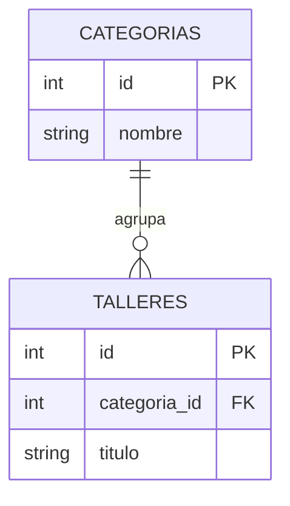

# Unidad 12. SQL, SQLite y PDO

[Anterior](../unidad11-sesiones/README.md) · [Índice](../README.md) · [Siguiente](../unidad13-crud/README.md)

[Práctica](PRACTICA.md) · [Soluciones](SOLUCIONES.md)

## Lo que aprenderás

Consultar datos con sentencias preparadas y restricciones.

Requisito: haber completado la unidad anterior. Si un concepto te cuesta, vuelve a su ejemplo antes de avanzar. Todos los comandos parten de `cursos/php`.

## Explicación

Una base relacional organiza filas en tablas. Una clave primaria identifica una fila; NOT NULL y CHECK expresan restricciones. SQL permite INSERT (crear), SELECT (leer), UPDATE (editar) y DELETE (borrar). Antes de esta unidad ya sabes validar los datos en PHP; la base también debe proteger sus reglas. Un WHERE ausente puede modificar todas las filas.

PDO es la interfaz de PHP para distintos motores. SQLite guarda la base en un archivo; `sqlite::memory:` crea una base temporal para pruebas. Necesitas el controlador pdo_sqlite: comprueba `php -r "print_r(PDO::getAvailableDrivers());"`. En Windows activa extension=pdo_sqlite en el php.ini que aparece en `php --ini`; en Linux instala el paquete SQLite de tu versión de PHP. Si aparece «could not find driver», revisa el intérprete y sus módulos antes de modificar el SQL.

Una sentencia preparada separa estructura SQL de valores: `prepare("... WHERE titulo = :titulo")` y `execute(["titulo" => $texto])`. No concatenes entradas en SQL. Los parámetros sirven para valores, no para nombres de tablas o columnas; para ordenar por una columna usa una lista explícita de opciones permitidas. PDO::ERRMODE_EXCEPTION facilita detectar fallos. Una transacción agrupa operaciones: commit conserva todas y rollBack revierte si no se completa el conjunto.

## Del arreglo a un modelo relacional

Un arreglo puede representar talleres durante una ejecución, pero una base relacional permite recuperar filas, aplicar restricciones y relacionar entidades. Diseña la tabla desde sus reglas: un taller tiene un ID estable, título obligatorio y cupo dentro de un rango. El ID no describe la posición en pantalla. El título no debe utilizarse como clave si dos talleres pueden compartirlo o si se editará después.

Una restricción de base protege la información aunque otra herramienta escriba sin usar tu formulario. La validación de PHP aporta mensajes comprensibles y normalización; el CHECK de SQL conserva la regla en almacenamiento. No hay contradicción en tener ambas capas: cumplen responsabilidades distintas. Si difieren, documenta cuál es el contrato y corrige la inconsistencia antes de aceptar datos.

### Leer una consulta por sus operaciones

SELECT elige columnas, FROM el origen, WHERE filtra, ORDER BY define el orden y LIMIT restringe la cantidad devuelta. La presentación de la consulta no significa que puedas prescindir de cualquiera de sus decisiones. Sin ORDER BY no debes prometer un orden estable. Sin una lista explícita de columnas puedes terminar exponiendo un campo añadido después que no formaba parte de la respuesta pública.

fetch obtiene la siguiente fila o false cuando no hay más, según su contrato. fetchAll reúne el conjunto; úsalo con listas acotadas, no con una descarga sin límite de una tabla enorme. fetchColumn es apropiado para un escalar como COUNT(*). Convertir ese conteo a int puede ser necesario para sostener el tipo que promete tu función. No interpretes false como una fila con valores vacíos.

### Relacionar tablas sin duplicar datos descriptivos

Si cada taller pertenece a una categoría, guarda categorías en otra tabla y relaciona categoria_id con su ID. Así cambiar el nombre de una categoría no exige actualizar cada taller. Una clave foránea expresa la relación. En SQLite, habilita PRAGMA foreign_keys = ON en cada conexión cuando el esquema utilice esas restricciones; no supongas que escribir la cláusula basta para cualquier configuración.

INNER JOIN conserva coincidencias entre las tablas. LEFT JOIN conserva además filas del lado izquierdo que no encuentran relación y completa con null la parte ausente. La decisión depende de si una categoría vacía debe aparecer en el informe. COUNT(talleres.id) cuenta coincidencias; COUNT(*) sobre una fila exterior de LEFT JOIN puede dar un resultado diferente al que esperabas para una categoría sin talleres.

### Visualiza la relación antes de escribir JOIN



Este modelo del laboratorio exige una categoría por taller y permite categorías sin talleres. El tercer ejemplo de la lección deja la columna nullable para poder discutir variantes; el esquema del laboratorio usa NOT NULL para la relación obligatoria. Un diagrama debe reflejar la variante que realmente implementas, no ocultar una diferencia en el SQL.

### Parámetros, identificadores y privilegios

Una consulta preparada mantiene separados el SQL y sus valores. Los parámetros no convierten una columna seleccionada por el usuario en un identificador seguro. Si la persona elige el orden, traduce opciones como reciente y titulo a fragmentos fijos de una lista permitida. Para LIMIT y OFFSET, enlaza enteros con PDO::PARAM_INT cuando esa sea la interfaz usada.

SQLite sirve para comenzar sin un servidor adicional. MySQL o PostgreSQL requieren conexión, credenciales, permisos y revisión de SQL. PDO ofrece una interfaz común, pero no hace idénticos los tipos, las funciones ni la concurrencia. No copies el archivo SQLite a un servidor MySQL esperando que se importe solo; una migración requiere esquema y transferencia de datos explícitos.

### Transacciones con un motivo concreto

Si una operación crea una inscripción y descuenta un cupo, guardar solo una parte dejaría el modelo inconsistente. Una transacción busca que ambas modificaciones se confirmen o ninguna se conserve. Comienza, ejecuta, confirma; ante un fallo revierte si sigue activa. Eso no elimina la necesidad de diseñar una actualización que respete concurrencia y restricciones.

En el [laboratorio SQL](../laboratorios/12-sql/README.md) construirás un informe con categorías, una transacción revertida y una consulta preparada. Es un trabajo CLI para concentrarte en las tablas antes de agregar HTTP. Describe cada fila esperada antes de ejecutar y contrasta especialmente la categoría que no tiene talleres.

## Ejemplo 1. Crear y consultar

Antes de ejecutar, predice la salida y señala qué instrucción produce cada línea.

[Archivo completo](ejemplos/01.php) · [Salida esperada](ejemplos/01.txt)

```php
<?php
declare(strict_types=1);

$db = new PDO("sqlite::memory:", null, null, [PDO::ATTR_ERRMODE => PDO::ERRMODE_EXCEPTION]);
$db->exec("CREATE TABLE talleres (id INTEGER PRIMARY KEY, titulo TEXT NOT NULL)");
$insertar = $db->prepare("INSERT INTO talleres (titulo) VALUES (:titulo)");
$insertar->execute(["titulo" => "PHP"]);
echo $db->query("SELECT titulo FROM talleres")->fetchColumn() . "\n";
```

```sh
php unidad12-pdo/ejemplos/01.php
```

Salida esperada:

```text
PHP
```

El esquema se crea primero, el parámetro se envía aparte y la consulta devuelve el título.

### Lectura por estados

| Momento | Qué ocurre |
|---|---|
| 1 | La conexión en memoria comienza sin tablas. |
| 2 | Se crea el esquema y se inserta PHP mediante un parámetro. |
| 3 | fetchColumn recupera el título de la fila creada. |

## Ejemplo 2. Un valor no se vuelve SQL

Antes de ejecutar, predice la salida y señala qué instrucción produce cada línea.

[Archivo completo](ejemplos/02.php) · [Salida esperada](ejemplos/02.txt)

```php
<?php
declare(strict_types=1);

$db = new PDO('sqlite::memory:');
$db->exec('CREATE TABLE talleres (titulo TEXT NOT NULL)');
$db->exec("INSERT INTO talleres VALUES ('PHP')");
$consulta = $db->prepare('SELECT COUNT(*) FROM talleres WHERE titulo = :titulo');
$consulta->execute(['titulo' => "' OR 1=1 --"]);
echo $consulta->fetchColumn() . " coincidencias\n";
```

```sh
php unidad12-pdo/ejemplos/02.php
```

Salida esperada:

```text
0 coincidencias
```

La entrada se busca literalmente como título, no modifica la condición SQL.

### Lectura por estados

| Momento | Qué ocurre |
|---|---|
| 1 | Existe exactamente un taller con título PHP. |
| 2 | El texto parecido a SQL se envía como parámetro de título. |
| 3 | Ninguna fila tiene ese título literal y el conteo es cero. |

## Ejemplo 3. Relacionar categorías y talleres

[Programa completo](ejemplos/03.php) · [Salida esperada](ejemplos/03.txt)

```php
<?php
declare(strict_types=1);

$db = new PDO("sqlite::memory:", null, null, [PDO::ATTR_ERRMODE => PDO::ERRMODE_EXCEPTION]);
$db->exec("PRAGMA foreign_keys = ON");
$db->exec("CREATE TABLE categorias (id INTEGER PRIMARY KEY, nombre TEXT NOT NULL)");
$db->exec("CREATE TABLE talleres (id INTEGER PRIMARY KEY, categoria_id INTEGER REFERENCES categorias(id), titulo TEXT NOT NULL)");
$db->exec("INSERT INTO categorias VALUES (1, 'Web'), (2, 'Robótica')");
$db->exec("INSERT INTO talleres VALUES (1, 1, 'PHP'), (2, 1, 'HTML')");
$sql = "SELECT c.nombre, COUNT(t.id) AS cantidad FROM categorias c
        LEFT JOIN talleres t ON t.categoria_id = c.id GROUP BY c.id, c.nombre ORDER BY c.id";
foreach ($db->query($sql, PDO::FETCH_ASSOC) as $fila) {
    echo $fila["nombre"] . ": " . $fila["cantidad"] . " talleres\n";
}
```

Ejecuta desde cursos/php:

```sh
php unidad12-pdo/ejemplos/03.php
```

Resultado que debes obtener:

```text
Web: 2 talleres
Robótica: 0 talleres
```

### Lectura guiada y experimentos

Las categorías se insertan antes que los talleres para que las relaciones tengan destino. LEFT JOIN conserva Robótica aunque no haya talleres asociados. COUNT(t.id) ignora los null de la coincidencia ausente y produce cero. Los alias c y t simplifican la consulta sin cambiar las tablas.

Sustituye LEFT JOIN por INNER JOIN: Robótica deja de aparecer. Después restaura el enlace exterior y compara COUNT(*) con COUNT(t.id). Esa diferencia explica por qué un informe puede tener SQL válido y un conteo equivocado. No trates el primer número obtenido como correcto sin relacionarlo con las filas de entrada.

## Comprueba tu comprensión

1. Inserta dos títulos y léelos con ORDER BY id.
2. Busca un título con comilla simple usando un parámetro.
3. Reto: inicia una transacción, inserta un taller y revierte; comprueba que no queda la fila.

Resuelve la [práctica](PRACTICA.md) antes de abrir las soluciones. Puedes avanzar cuando explicas la salida, modificas el ejemplo y justificas un caso límite.

[Anterior](../unidad11-sesiones/README.md) · [Índice](../README.md) · [Siguiente](../unidad13-crud/README.md)
