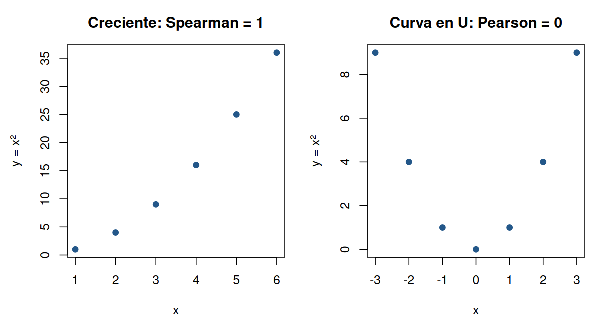
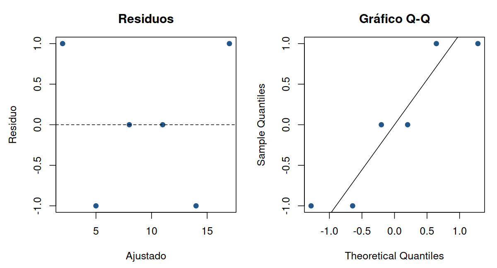

# Unidad 16. Correlación y regresión lineal introductoria

[Anterior](../unidad15-inferencia/README.md) · [Índice](../README.md) · [Siguiente](../unidad17-reproducibilidad/README.md)

[Práctica paso a paso](PRACTICA.md) · [Soluciones (después de intentar)](SOLUCIONES.md)

## Objetivos

- Calcular e interpretar Pearson y Spearman, conservando los pares observados.
- Leer pendiente, intercepto y unidad de predicción.
- Examinar residuos y rango de datos.
- Separar asociación, ajuste, incertidumbre y causalidad.

## Antes de ajustar una recta: comprender la correlación

Cada punto debe reunir dos mediciones de la misma unidad. La correlación no tiene unidades: describe asociación y está entre -1 y 1. El signo indica la dirección; su magnitud necesita contexto, gráfico y tamaño de muestra. No hay un umbral universal que convierta un coeficiente en una relación importante.

### Pearson y Spearman responden preguntas diferentes

| Método | Qué resume | Qué revisar antes de interpretarlo |
|---|---|---|
| Pearson | Asociación lineal entre dos variables cuantitativas | Dispersión, valores extremos, variación y rango observado |
| Spearman | Asociación monótona mediante rangos (tendencia a aumentar o disminuir) | Orden significativo, empates y forma de la relación |

Para `x = 1:6` e `y = x^2`, los valores aumentan juntos, pero forman una curva. Pearson es aproximadamente 0.979 y Spearman es 1: los rangos coinciden exactamente. Spearman no demuestra linealidad. Tampoco se elige un método buscando el p-valor más pequeño: declara primero qué asociación quieres estudiar. Para categorías sin orden, asignar números arbitrarios no justifica ninguno de los dos.

Pearson se reconstruye centrando cada variable, sumando los productos de desviaciones y dividiendo por la raíz del producto de las dos sumas de cuadrados. El Ejemplo 3 contrasta esa cuenta con `cor`. Si una variable es constante, su dispersión es cero y la correlación queda indefinida; no reemplaces ese resultado por cero.

### Primero mira la forma



A la izquierda, el orden aumenta aunque la pendiente cambia. A la derecha, los valores de `y = x^2` bajan y luego suben: Pearson es cero por simetría. El gráfico muestra por qué **cero no implica ausencia de cualquier relación**. Los puntos son construidos para aprender; no representan una muestra real.

### Conservar los pares y contar las exclusiones

Si a una fila le falta x o y, falta el par para este cálculo. `complete.cases(d)` identifica filas completas; el ejemplo conserva seis de ocho y declara las dos excluidas. Quitar los NA de cada columna por separado puede emparejar personas distintas. Trabajar con pares completos tampoco demuestra que los faltantes sean aleatorios ni elimina un posible sesgo.

### Qué añade cor.test

`cor` devuelve el coeficiente; `cor.test` añade un contraste bajo supuestos. Con Pearson, `estimate` es r, `conf.int` contiene el intervalo y `p.value` el p-valor para la hipótesis de correlación poblacional cero. La inferencia clásica exige pares independientes y un modelo apropiado (normal bivariado para la prueba t exacta); calcular el coeficiente descriptivo no exige por sí solo esa normalidad.

El Ejemplo 3 permite inspeccionar esos campos con seis pares artificiales. El intervalo de Pearson usa una aproximación de Fisher y con tan pocos pares merece especial cautela. El p-valor no expresa la probabilidad de que haya causalidad ni de que la hipótesis sea verdadera. Para Spearman, la aproximación del contraste depende del tamaño y de los empates; `cor.test` no entrega el mismo intervalo de Pearson. Consulta la ayuda de [cor](https://stat.ethz.ch/R-manual/R-devel/library/stats/html/cor.html) y [cor.test](https://stat.ethz.ch/R-manual/R-devel/library/stats/html/cor.test.html).

## Clase guiada. Leer una recta ajustada sin confundirla con una causa

Una regresión lineal simple representa una relación media de respuesta con predictor mediante intercepto y pendiente. El laboratorio construye seis pares con horas de 0 a 5 y puntajes próximos a una recta. Los valores son docentes y no representan evidencia sobre estudiar más horas en una población real.

### 1. Declara respuesta y predictor

lm(puntaje~horas, data=d) coloca la respuesta a la izquierda de ~ y el predictor a la derecha. La fórmula describe el modelo; no significa asignación ni demuestra dirección causal. coef devuelve los coeficientes estimados: (Intercept) corresponde al intercepto y horas a la pendiente.

En este caso la recta es puntaje ajustado=2+3×horas. El intercepto describe la predicción en horas 0, dentro del rango construido. En otro estudio, cero podría quedar fuera del rango o carecer de sentido sustantivo. La pendiente 3 expresa tres unidades de puntaje por una hora adicional en la relación ajustada; no afirma un efecto de una intervención.

### 2. Reconstruye una predicción

Para 2.5 horas, calcula 2+3×2.5=9.5. predict recibe una tabla newdata cuya columna debe llamarse horas, como el predictor del modelo. No basta pasar una cantidad con otro nombre. Es una predicción del modelo para ese predictor y no un intervalo para un individuo futuro.

### 3. Calcula un residuo de una fila

En la primera fila el observado es 3, el ajustado en horas 0 es 2 y el residuo es 3-2=1. fitted devuelve ajustados y residuals devuelve diferencias observado-ajustado. Un residuo negativo indica que el observado quedó por debajo de la recta. No se interpreta como un dato imposible ni se elimina automáticamente.

| Horas | Observado | Ajustado | Residuo |
|---|---|---|---|
| 0 | 3 | 2 | 1 |
| 1 | 4 | 5 | -1 |
| 2 | 8 | 8 | 0 |

### 4. Separa ajuste y diagnóstico

Los mínimos cuadrados eligen coeficientes que minimizan la suma de residuos al cuadrado dentro del modelo planteado. Un buen ajuste de estos datos no valida automáticamente forma lineal, independencia, varianza, distribución para inferencia ni extrapolación. Los gráficos de residuos y Q-Q orientan la revisión; con solo seis casos construidos no certifican condiciones de un estudio real.

### 5. Cambia unidades, no el fenómeno

Al expresar horas en minutos, la pendiente pasa de 3 por hora a 0.05 por minuto. La predicción en 150 minutos sigue siendo 9.5. El número del coeficiente aislado carece de interpretación sin unidad. Pedir una predicción en 20 horas, fuera de [0, 5], es extrapolar: el software puede calcularla aunque no exista soporte observado para ese rango.

## Laboratorio guiado

[Archivo completo](ejemplos/laboratorio.R) · [Salida comprobada](ejemplos/laboratorio.txt)

Predice primero, ejecuta el archivo completo y lee después la explicación.

```r
# Laboratorio guiado. Ejecutar desde cursos/r.
d <- data.frame(horas = 0:5, puntaje = 2 + 3 * (0:5) + c(1, -1, 0, 0, -1, 1))
m <- lm(puntaje ~ horas, data = d)
intercepto <- unname(coef(m)["(Intercept)"])
pendiente <- unname(coef(m)["horas"])
predicha <- intercepto + pendiente * 2.5
primera_ajustada <- fitted(m)[1]
primer_residuo <- d$puntaje[1] - primera_ajustada
stopifnot(abs(predicha - 9.5) < 1e-10, abs(primer_residuo - 1) < 1e-10)
cat(sprintf("Recta: puntaje = %.1f + %.1f * horas\n", intercepto, pendiente))
cat(sprintf("Para 2.5 horas: %.1f; primera fila: observado=3, ajustado=%.1f, residuo=%.1f\n", predicha, primera_ajustada, primer_residuo))
```

Desde la terminal del proyecto:

```text
Rscript --vanilla unidad16-regresion/ejemplos/laboratorio.R
```

Salida esperada:

```text
Recta: puntaje = 2.0 + 3.0 * horas
Para 2.5 horas: 9.5; primera fila: observado=3, ajustado=2.0, residuo=1.0
```

### Lectura del laboratorio

Se extraen coeficientes por nombre y se calcula la predicción con la ecuación, no solo con predict. La última salida reconstruye un residuo individual. Escribe una interpretación de signo y unidad antes de pasar al gráfico de diagnóstico del Ejemplo 02.

## Experimenta

Calcula la predicción en 3 horas mediante la ecuación y con predict: ambas deben ser 11. Después expresa la entrada en 180 minutos usando el modelo correspondiente. No envíes 180 al modelo en horas: cambiar la unidad de la entrada sin cambiar el modelo altera el significado.

## Errores frecuentes

| Error | Revisión |
|---|---|
| Leer la pendiente sin unidad | Identifica respuesta por unidad de predictor |
| Confundir residuo con predicción | Reconstruye observado-ajustado |
| Tratar fórmula como causalidad | Revisa diseño, selección y variables omitidas |
| Confiar en cualquier valor que predict devuelve | Comprueba el rango observado y el propósito |

## Autoevaluación

¿Por qué Spearman es 1 en la curva creciente? ¿Por qué Pearson es cero en la curva en U? ¿Qué filas excluyes al trabajar con pares completos?

¿Qué significa ~ en el ajuste? ¿Por qué la pendiente cambia al pasar a minutos? ¿Qué indica un residuo positivo? ¿Qué información faltaría para atribuir causalidad a una pendiente?


## Un modelo expresa una relación condicionada

lm(y~x,data=d) ajusta una relación lineal con intercepto. En el caso construido, y contiene 2+3x más desviaciones. El ajuste recupera intercepto 2 y pendiente 3. El intercepto corresponde a la respuesta modelada en x=0 y la pendiente al cambio de respuesta modelada por una unidad de x.

Esa interpretación requiere conservar unidades y contexto. La pendiente puede cambiar numéricamente si pasas de horas a minutos sin cambiar la relación subyacente. La solución obtiene 0.05 por minuto, equivalente a 3 por hora.

## Predicción dentro y fuera del rango

En x=2.5, el valor ajustado es 9.5. x=20 queda fuera del rango observado [0,5]. El programa puede producir una extrapolación, pero la existencia de un resultado no demuestra que el modelo siga siendo adecuado allí.

Una predicción puntual no representa toda la incertidumbre. Para comunicarla, distingue incertidumbre de la media modelada y variación de una observación futura, bajo los supuestos del modelo. La ruta introduce esas preguntas sin convertir un ajuste pequeño en una herramienta de decisión validada.

## Residuos y diagnóstico

El residuo es observado menos ajustado. Con intercepto, los residuos del ajuste de mínimos cuadrados suman aproximadamente cero; eso no significa que todos sean cero ni que el modelo sea correcto.

El gráfico residuos/ajustados permite buscar patrones y cambios de dispersión. El gráfico Q-Q orienta la revisión de una distribución de residuos para el uso inferencial correspondiente. Seis observaciones ofrecen diagnóstico limitado. Una figura o un test no certifican automáticamente linealidad, independencia, varianza o normalidad.

## Correlación y causalidad

La correlación resume asociación lineal y depende de qué unidades, rango y datos estás observando. Una asociación alta no demuestra que intervenir sobre x produzca el cambio de y indicado por la pendiente. Variables omitidas, selección, temporalidad y diseño importan.

El Ejemplo 01 comprueba coeficientes y predicción de un caso construido; el segundo conserva residuos no nulos y señala extrapolación. El proyecto final describe su archivo ficticio sin afirmar efectos causales de la modalidad.

## Qué revisar antes de usar el modelo

Define resultado, predictores, unidad, propósito y población de aplicación. Examina datos y residuos, registra transformaciones y datos excluidos y evalúa el modelo para su finalidad. Si el objetivo es predicción, el desempeño fuera de los datos usados para ajustar requiere evaluación adicional; un buen ajuste dentro de la tabla no la sustituye.

## Ejemplos completos

Ejecuta uno cada vez desde la raíz del curso. Predice la salida antes de comprobarla. Las condiciones stopifnot comprueban expectativas y detienen el archivo si no se cumplen.

### Ejemplo 1. Coeficientes y predicción dentro del rango

[Archivo R](ejemplos/01.R) · [Salida](ejemplos/01.txt)

```r
# Coeficientes y predicción dentro del rango
# Ejecutar desde la raíz del curso, con Rscript --vanilla.
d <- data.frame(x = 0:5, y = 2 + 3 * (0:5) + c(1, -1, 0, 0, -1, 1))
m <- lm(y ~ x, data = d)
p <- predict(m, newdata = data.frame(x = 2.5))
stopifnot(isTRUE(all.equal(unname(coef(m)), c(2, 3), tolerance = 1e-10)))
stopifnot(abs(unname(p) - 9.5) < 1e-10)
cat("Ajuste construido: intercepto=2; pendiente=3; predicción en x=2.5: 9.5
")
cat("La pendiente describe asociación en el modelo, no un efecto causal demostrado.
")
```

Desde una terminal del proyecto:

```text
Rscript --vanilla unidad16-regresion/ejemplos/01.R
```

Salida esperada:

```text
Ajuste construido: intercepto=2; pendiente=3; predicción en x=2.5: 9.5
La pendiente describe asociación en el modelo, no un efecto causal demostrado.
```

### Ejemplo 2. Residuos y extrapolación

[Archivo R](ejemplos/02.R) · [Salida](ejemplos/02.txt)

```r
# Residuos y extrapolación
# Ejecutar desde la raíz del curso, con Rscript --vanilla.
d <- data.frame(x = 0:5, y = 2 + 3 * (0:5) + c(1, -1, 0, 0, -1, 1))
m <- lm(y ~ x, data = d)
stopifnot(abs(sum(residuals(m))) < 1e-10, sum(residuals(m)^2) > 0)
fuera <- 20 < min(d$x) || 20 > max(d$x)
stopifnot(fuera)
dir.create("salidas/graficos", recursive = TRUE, showWarnings = FALSE)
svg("salidas/graficos/diagnostico.svg", width = 8, height = 4)
par(mfrow = c(1, 2))
plot(fitted(m), residuals(m), xlab = "Ajustado", ylab = "Residuo", main = "Residuos")
abline(h = 0, lty = 2)
qqnorm(residuals(m), main = "Gráfico Q-Q"); qqline(residuals(m))
invisible(dev.off())
cat("Residuos no nulos; x=20 está fuera del rango observado [0,5]
")
cat("Un gráfico diagnóstico orienta revisión; no certifica por sí solo los supuestos.
")
```

Desde una terminal del proyecto:

```text
Rscript --vanilla unidad16-regresion/ejemplos/02.R
```

Salida esperada:

```text
Residuos no nulos; x=20 está fuera del rango observado [0,5]
Un gráfico diagnóstico orienta revisión; no certifica por sí solo los supuestos.
```



**Qué observar:** en el panel izquierdo hay residuos positivos, negativos y cero. La línea horizontal es una referencia, no el ajuste de otra regresión. En el Q-Q, compara puntos y recta de referencia; con seis datos construidos no concluyas que se ha comprobado normalidad. Estas imágenes se reconstruyen con el [script de figuras](../scripts/generar_figuras.R).

## Ejemplo 3. Correlación, contraste y faltantes

[Archivo R](ejemplos/03.R) · [Salida](ejemplos/03.txt)

```r
# Pearson, Spearman y una relación que un coeficiente puede ocultar.
# Ejecutar desde cursos/r. Datos construidos, sin inferencia poblacional real.
x <- 1:6
y <- x^2
pearson <- cor(x, y, method = "pearson")
spearman <- cor(x, y, method = "spearman")
manual <- sum((x - mean(x)) * (y - mean(y))) /
  sqrt(sum((x - mean(x))^2) * sum((y - mean(y))^2))
stopifnot(abs(pearson - manual) < 1e-12, pearson < 1,
          abs(spearman - 1) < 1e-12)
prueba <- cor.test(x, y, method = "pearson", conf.level = 0.95)
stopifnot(abs(unname(prueba$estimate) - pearson) < 1e-12,
          unname(prueba$parameter) == 4, length(prueba$conf.int) == 2)
cat(sprintf("Curva creciente: Pearson=%.3f; Spearman=%.3f; n=%d.\n",
            pearson, spearman, length(x)))
cat(sprintf("Pearson: IC95%%=[%.3f, %.3f]; p=%.6f.\n",
            prueba$conf.int[1], prueba$conf.int[2], prueba$p.value))
# Conservar los pares: nunca eliminar faltantes de cada columna por separado.
d <- data.frame(x = c(x, NA, 8), y = c(y, 49, NA))
completos <- complete.cases(d)
stopifnot(sum(completos) == 6, sum(!completos) == 2,
          abs(cor(d$x, d$y, use = "complete.obs") - pearson) < 1e-12)
cat("Faltantes: 8 filas, 6 pares completos y 2 filas excluidas.\n")
u <- -3:3
r_curva <- cor(u, u^2)
stopifnot(abs(r_curva) < 1e-12)
cat(sprintf("Curva en U: Pearson=%.3f; cero no significa ausencia de relación.\n", r_curva))
```

Desde la raíz del curso:

```text
Rscript --vanilla unidad16-regresion/ejemplos/03.R
```

Salida esperada:

```text
Curva creciente: Pearson=0.979; Spearman=1.000; n=6.
Pearson: IC95%=[0.814, 0.998]; p=0.000662.
Faltantes: 8 filas, 6 pares completos y 2 filas excluidas.
Curva en U: Pearson=0.000; cero no significa ausencia de relación.
```

## Para avanzar

Resuelve la [práctica](PRACTICA.md), compara el resultado con tu predicción y justifica la decisión antes de consultar las soluciones. Si modificas código, repite la [verificación del curso](../docs/VERIFICACION.md).

[Anterior](../unidad15-inferencia/README.md) · [Índice](../README.md) · [Siguiente](../unidad17-reproducibilidad/README.md)

---

### ¿Necesitas apoyo con este tema?

Si necesitas comprender una parte, resolver un error o adaptar la práctica a tu proyecto, podemos trabajarlo en una sesión personalizada.

[**Consultar asesoría por WhatsApp**](https://wa.me/573103618296?text=Hola%2C%20Leli.%20Estoy%20estudiando%20la%20Unidad%2016%20%28Correlaci%C3%B3n%20y%20regresi%C3%B3n%20lineal%20introductoria%29%20del%20curso%20R%20desde%20cero%20para%20an%C3%A1lisis%20de%20datos%20e%20investigaci%C3%B3n%20y%20necesito%20asesor%C3%ADa.%20Mi%20duda%20es%E2%80%A6)
